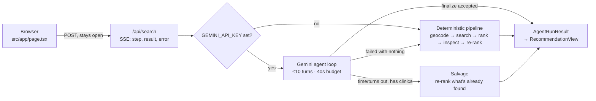

# ClinicScout Internals

A visual walkthrough of how a search actually moves through the app — one
request, traced end to end. [README.md](README.md) covers *why* the
load-bearing decisions were made; [ARCHITECTURE.md](ARCHITECTURE.md) is the
full structural reference, including the layer boundaries under `src/`. This
doc is the guided version of both: follow it top to bottom to see the whole
flow at a glance.

## 1. The big picture

A search is a single `POST /api/search` that stays open as a
Server-Sent-Events stream — the browser never polls; each step renders the
moment it happens. One fork picks the engine, and three different paths can
produce the final recommendation.

Whichever branch runs, the output is the same shape — the client never has to
special-case which engine answered. The deterministic pipeline sits under
*three* of the four paths out of that fork — it's not just a no-key fallback,
it's also what runs when the agent runs out of runway or fails outright.

## 2. One request, three endings

The step log always names which engine answered, because that's exactly the
kind of thing this app is otherwise careful never to leave implicit.

| Outcome | `mode` | When it happens |
|---|---|---|
| **Agent finalized** | `agent` | The model called `finalize_recommendation` and it passed validation. |
| **Salvage** | `deterministic` | The loop ran out of time or turns, or lost the model mid-run — but had already found clinics, so that work gets scored rather than thrown away. |
| **Fixed pipeline** | `deterministic` | No API key configured, or the agent failed before gathering anything at all. |

A geocoding or directory failure raises an error *before* either engine can
produce anything — that path exits ahead of the fork, not after it.

### Why the numbers are what they are

Every budget below is chained to the deployment ceiling, not picked freely.

| Budget | Value | Why |
|---|---|---|
| Vercel Hobby function ceiling | **60s** | The hard limit — `maxDuration` in `src/app/api/search/route.ts` |
| Agent loop budget | **40s** | Leaves room to fall back and still answer rather than dying mid-stream |
| Max turns | **10** | Each turn is a round-trip against a free-tier quota |

## 3. Where state lives

The agent's blackboard is `RunState` (`src/application/search/agentState.ts`), and
the boundary drawn around it is the reason a model can be put in charge of a
medical lookup at all.

**Full clinic records never enter the model's context.** Tools hand Gemini a
compact projection plus a short id like `node/123`, and read the real record
back out by id server-side. Two things follow: a dense city's hundred
listings can't swamp the context window, and it's structurally impossible for
the model to alter a clinic fact — it can only ever point at one.

What accumulates in `RunState` across a run: clinics found so far (deduped by
id, surviving a widened re-search with their inspection results intact),
excluded specialty listings, the radius actually searched, which clinics have
already been inspected, and the finalization once it's accepted.

## 4. The fact firewall

Two different moments ask the same question — *is there anything real behind
this claim?* — and answer it the same way: discard rather than soften.

**Lane A — a fact entering from a website**

A clinic's site is fetched (SSRF-guarded, 3 pages max) and Gemini extracts a
field value plus a claimed supporting quote. `verifyAgainstPage`
(`src/domain/verification/pageEvidence.ts`) checks: does that quote actually
appear on the fetched page, verbatim?

- ✅ **Kept** — written to the record, confidence raised to High
- ❌ **Discarded** — field forced to `null` → renders "Unknown"

**Lane B — a fact the agent cites to justify a pick**

`finalize_recommendation` arrives with a `clinic_id`, a reason, and the
`cited_fields` the reasoning depends on. `validateFinalization`
(`src/application/search/citationGuard.ts`) checks: is every cited field
confirmed (not null) — and is the pick reachable, and not closed while the
request is urgent?

- ✅ **Accepted** — promoted to rank 1, reasoning shown as reasoning
- ❌ **Rejected** — sent back as a tool error — the model retries

Lane A decides what a clinic record is allowed to *contain*. Lane B decides
what the agent is allowed to *say* about it — and carries an extra gate Lane
A doesn't need, because a verified fact can still add up to an unusable
recommendation.

Lane A relies on one primitive — `findVerbatimMatch` in
`src/domain/verification/quoteMatch.ts` — for the actual "does this quote
appear verbatim" check, evaluated against the whole fetched page text. Lane
B never calls it directly: a cited field passing Lane B's check means it was
already confirmed non-null by Lane A.

### The usability floor

The agent is free to overrule the deterministic ranking below, and most of
that waterfall really is a judgment call. Two checks aren't, because a wrong
call there hands a sick person a clinic they can't reach or one that's shut —
both were observed happening in testing, which is why they're enforced in
code rather than requested in the prompt.

| Floor | Rule |
|---|---|
| **Reachability** | No address, phone, email, or booking link is a name, not a recommendation — can't be finalized while any reachable alternative exists. |
| **Urgency** | A confirmed-closed clinic can't be finalized for an urgent request while any alternative might be open. Unknown hours pass — unknown might mean open. |

Each check only bites while a genuinely better option exists — if every
nearby clinic is a dead end, saying so honestly is the best answer available,
and the agent is free to give it.

## 5. The priority waterfall

`rank_clinics` (`src/domain/policies/rankClinics.ts`) compares tier by tier —
a tie falls through to the next criterion instead of collapsing into one sort
key. The agent can recommend a lower tier, but only by citing a confirmed
fact the waterfall couldn't see.

| Tier | Criterion | Note |
|---|---|---|
| 0 | Usable at all | No contact channel *and* no address sinks a listing regardless of everything below |
| 1 | Open right now | Confirmed open beats unknown beats confirmed closed |
| 2 | Relevance | `walk_in` > `general` > `unknown` |
| 3 | Walk-ins explicitly confirmed | |
| 4 | Capacity or wait time known | |
| 5 | No appointment required | Skipped for routine care — you can book ahead |
| 6 | Reachable by some contact channel | Deliberately above distance: reachable beats 100m closer but silent |
| 7 | Shortest distance | |
| 8 | Higher source confidence | |

## 6. Where each piece lives

All paths are under `src/`, organized by
[Clean Architecture layer](ARCHITECTURE.md#layering). The module-by-module
breakdown lives in [ARCHITECTURE.md's module map](ARCHITECTURE.md#module-map)
— restating it here as a second set of tables is exactly what let this
section fall out of sync with three shipped subsystems (rate limiting,
accounts/auth, Redis) until a manual pass caught it. What each layer is for,
in one line:

| Layer | What it's for |
|---|---|
| [Presentation — client](ARCHITECTURE.md#presentation--client) | Next.js routes, React components, the SSE client hook |
| [Interface — API](ARCHITECTURE.md#interface--api) | Route handlers and the HTTP-framing helpers they share |
| [Application — search orchestration](ARCHITECTURE.md#application--search-orchestration) | The engine fork, the turn loop, and the citation guard |
| [Application — ports](ARCHITECTURE.md#application--ports) | The interfaces application code depends on instead of concrete infrastructure |
| [Domain](ARCHITECTURE.md#domain--entities-policies-verification) | Entities, pure policies, and the fact-verification primitives |
| [Infrastructure — adapters](ARCHITECTURE.md#infrastructure--adapters) | Geocoding, the clinic directory, website fetching, Gemini, cache, rate limiting, auth, config, fixtures, logging |

## 7. Tests & failure handling

`node --test` over `src/**/*.test.ts`, colocated beside the source each file
tests. No network access — the agent loop takes `callModel` and `runTool` as
parameters precisely so a whole run can be driven from a scripted transcript
without a key.

| Stat | Value |
|---|---|
| Repeat search, cache hit vs. cold | **~7s → ~400ms** (confirmed live) |
| Overpass result cache TTL | **24h** — expired cache still beats no result |
| `gemini-2.5-flash` free-tier request cap | **20/day** ≈ 3 agent runs |

Coverage leans toward the places where being wrong would be *dangerous*
rather than merely incorrect:

- `citationGuard.test.ts` — the citation check and both usability floors
- `runGeminiAgentUseCase.test.ts` — budget and turn-cap termination, salvage, the finalize nudge
- `pageEvidence.test.ts` — fabricated and paraphrased quotes dropping their fields
- `openingHours.test.ts` — the parser refusing to guess
- `classifyClinic.test.ts` — specialty names beating walk-in names
- `excludeSpecialtyListings.test.ts` — the agent path and deterministic pipeline agreeing on the same input
- `redisCache.test.ts` — the stale-read contract and failing open on a transport error, against a fake transport
- `redisRateLimiter.test.ts` — the INCR+EXPIRE window, and falling back to the full window when a TTL is unexpectedly missing

Model pinned to `gemini-2.5-flash` rather than an alias —
`gemini-flash-latest` resolved to a preview model with a much tighter quota
and caused a live 429 storm during testing. A demo failing under load is
worse than eventually bumping a pinned id by hand.
